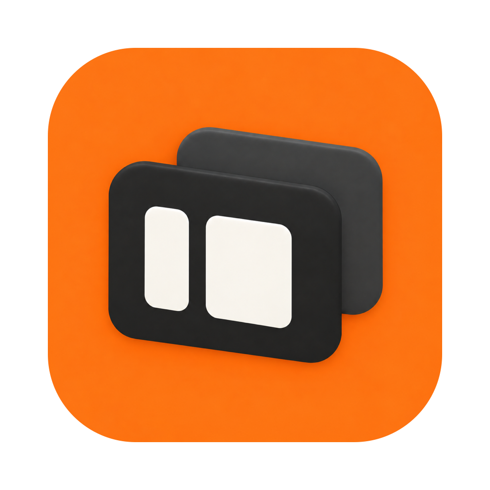

# AgentDeck



AgentDeck 是 Coding Agent 的统一原生桌面客户端。产品目标仍是把 Codex 和
Claude Code 作为一等公民放进同一个工作台；当前实现处于桌面端重启阶段。

## 当前状态

macOS 旧 AppKit 客户端已经移除。新的 `agentdeck-desktop` 使用 Rust、
[GPUI](https://crates.io/crates/gpui) 和
[gpui-component](https://crates.io/crates/gpui-component) 从最小壳开始迭代。

当前桌面端只承诺：

- 创建 GPUI 桌面窗口，macOS 使用透明标题栏；Linux/Windows 的构建与验收范围见[发布说明](docs/RELEASE.md)。
- 初始化 `gpui-component` 并挂载 `Root`。
- 界面固定使用深色，配色来自设计系统 SSOT 生成的 codex 颜色；警告使用与品牌橙区分的琥珀色。
- 渲染外壳布局：全高左侧栏（品牌行 / 新建会话与搜索框 / 按日期分组的会话列表 /
  底部页面入口图标）、空态（统计胶囊与居中标题、按已注册 agent 生成的固定列栅格卡片，卡片主体筛选会话、右上角“＋”新建会话，卡片随窗口收窄，内容过高时可纵向滚动），
  会话态（thread header 与 agent / 项目 / 机器标签、用户消息右对齐气泡且每轮首条助手消息标注 agent 身份的会话记录、底部消息输入框与审批条），以及机器管理页。
- **接入本机及 SSH 远端 `agentdeckd` 的只读历史**：启动时先问各机器的 daemon 注册了哪些 agent，再按
  agent 分别拉取会话列表（首批各显示 50 条），谁先返回谁先进侧栏；侧栏提供“刷新”按钮重新读取各机器的最新会话列表，刷新期间及失败时保留已有会话与计数；固定在列表下方的
  “加载更多”为仍有更多的来源（有 agent 过滤时只为该来源）各扩展 50 条。读完或达到
  每来源 2,000 条上限时在机器页的 agent 行中提示；继续加载或失败时保留已有会话与计数。点击条目按
  `threadId` + `agentKind` 读取该会话的真实记录。助手消息按 Markdown 渲染，代码块带
  语法高亮与复制按钮；用户消息暂保持纯文本，避免注入标签被当作 HTML 吞掉。命令、思考、
  工具、变更默认折叠为一行摘要，单行命令、思考和图片路径也可展开；命令的状态、退出码
  与耗时独立显示，失败标红。连续两个以上的过程块再合成一行默认折叠的“过程”组摘要
  （步数、各类计数与失败数），折叠时仅占一个虚拟列表项，展开后成员按可见区域渲染，
  各块仍保持各自的折叠状态；组摘要在读取完成时计算。会话记录右侧常驻滚动条，上下渐隐区留足滚动空间，首尾内容可完整显示；
  打开会话时量出全部行高，滚动条按整段会话计算长度，流式更新只重排变动的尾部；右侧小点 rail 对应每条用户消息，
  当前轮高亮、悬停看摘要、点击跳转，往上翻看时右下角出现“回到最新”按钮。Markdown 图片暂显示说明与目标链接／路径，不加载图片。
  工具参数和结果只折叠明确标记的 base64 data URI，普通字符串保留文本展示；单段原文
  仍有 2000 字符上限。加载中、失败和空结果都有明确文案；某个来源失败时保留其他来源
  的会话，机器页 agent 行显示“读取失败”、错误原因与重试按钮。
  只读请求中可恢复的传输失败在后台等待 1 秒自动重试一次；daemon 明确返回的错误（含超时）
  直接显示，定位、配置和响应解析错误也不自动重试。失败时提供连接、来源列表或正文的
  重试按钮，加载期间不重复发起同一请求；加载更多失败后重试相同目标数量。
  快速切换时最多执行一个历史读取，只保留最新待查会话；记录文本在后台读取完成时
  转换一次，滚动时复用。会话记录（变高 `list`）和侧栏会话列表（等高
  `uniform_list`）都只渲染可见区域附近的条目，长会话滚动不再逐帧排版全部内容。
  侧栏会话按本地日期分为“今天 / 昨天 / 近 7 天 / 更早”，行尾显示时间（今天与昨天为
  时:分，其余本年为月/日、跨年为年/月/日，未知时间留空）；本客户端续聊中的会话在跑时行尾改为绿色“工作中”，
  有待决审批或提问时为黄色“待确认”（其他客户端或 CLI 里运行的会话不显示）。每条会话带 16px 来源像素图标，静止时为灰色，悬停或键盘光标所在行显示彩色。
  Codex 为蓝色宠物 [Codey](https://learn.chatgpt.com/docs/pets) 的简化版，
  Claude Code 为暖橙色小螃蟹。来源图标从 `assets/agents/` 编译期嵌入并共享缓存，
  使用 32px PNG 显示为 16px，保持 Retina 下的像素边界，避免滚动时逐像素提交绘制。
  悬停显示信息卡：标题最多三行，底部显示文件夹名和弱化的完整路径。
  列表中的长标题以省略号显示；Tab 聚焦会话列表后，用上下键移动并自动滚动到目标条目，
  导航到组首会话时保留其日期标题；Return 打开会话，Tab / Shift-Tab 离开列表。
- 侧栏搜索框按会话标题或项目名（不区分大小写）实时过滤列表；点击空态的 agent 卡片
  或机器页的 agent 行只看该 agent 的会话，选中时以边框标识，再点取消。两种过滤可叠加，无结果时显示
  “没有匹配的会话”。
- 侧栏左下角的服务器图标进入独立的机器管理页，每个 agent 行显示该机器上 Claude Code / Codex 的实际安装版本，并可一键运行 CLI 自带的更新命令（`claude update` / `codex update`）；连接框下方列出 `~/.ssh/config`（含 `Include`）里尚未连接的主机，点击即添加；已添加的远端保存在数据目录的 `desktop-remotes` 文件；悬停提示显示连接中或失败台数，连接或任一来源历史读取失败时图标标红。
  版本查询完成但拿不到版本号时显示「安装」，取得版本号时显示「更新」；拿不到版本号也可能是探测失败，不直接判定未安装。
  安装使用官方原生脚本，在对应机器上执行：Unix 上 Codex 为 `curl -fsSL https://chatgpt.com/codex/install.sh | sh`，Claude Code 为 `curl -fsSL https://claude.ai/install.sh | bash`，均不依赖 npm。
  Windows 使用同一官方站点的 `install.ps1`，通过 PowerShell 执行，不修改执行策略；CLI 只接受原生 `.exe`，不执行 `.cmd` / `.bat` wrapper。发现位置与限制见[发布说明](docs/RELEASE.md#windows-桌面x64)。
  Codex 使用官方 `CODEX_NON_INTERACTIVE=1` 跳过安装器询问，不自动启动登录或卸载其他渠道的安装。
  安装／更新均需二次确认，且要求 daemon 与桌面端协议一致（当前 v9）；旧 daemon 仍可读取历史，操作按钮禁用并提示先更新／重装 daemon。
  请求不自动重试；断开或超时会终止安装／更新进程及其子进程。CLI 操作期间不能同时重装该机器的 daemon。
  安装结束后重新探测版本并刷新历史；首次登录须在目标机器运行官方 CLI 完成，AgentDeck 不处理登录凭据。
  App 内置的 Codex 不运行 CLI 自更新，点击更新会提示通过对应 App 更新；独立安装的 Codex 仍使用自身更新命令。
  远端 agentdeckd 安装期间暂不能断开该机器，安装结束后恢复，结果保留在机器卡片中。
  机器页每台机器一张卡片：状态胶囊、名称、重试 / 断开、完整连接错误，以及各 agent 的
  完整状态、兼容性警告和读取错误；顶部是常驻的远端连接输入框。
- 点击主页 agent 卡片右上角“＋”，在对应机器与 agent 上新建会话。发送首条消息前可填写工作目录绝对路径：
  默认取该来源最近会话的目录，本机无历史时使用用户目录（Unix 为 HOME，Windows 优先 USERPROFILE），远端无历史时留空待填；目录为空时不能发送。
  工作目录在输入栏左侧以项目按钮呈现，只显示目录名，完整路径在悬停提示里；下拉列出这台机器最近会话用过的目录（不分 agent，去重，最多 8 个），
  每项附上级目录提示（本机用户目录缩写为 `~`）；本机另有“浏览…”调起系统目录选择器，“输入路径…”展开手填框。远端无历史时直接显示手填框。
  首条消息发出后等待 daemon 返回真实 threadId，再将会话加入侧栏；初始标题取首条消息的首行。
- 会话态底部是消息输入框（Enter 发送，macOS 为 ⌘Enter 换行，Linux/Windows 为 Ctrl+Enter，运行中切为“停止”）：首次发送使用
  `SessionStart`，已有会话携带原 threadId 续聊，新建会话不带 resumeThreadId；之后同一 daemon 会话内发 `TurnStart`。
  流式条目接在历史记录之后，按 agent 与会话声明的能力启用发送和审批；能力查询失败可就地重试。
  命令与工具卡片行尾统一显示状态与耗时（“运行中 · 30.0s”“失败 · 1.5s”），Claude Code 长时间运行的工具每约 30 秒刷新一次耗时。
  工具审批按到达顺序在输入框上方显示审批卡（命令、patch、写入内容或计划全文；拒绝 / 允许 / 总是允许，计划为
  继续规划 / 开始执行，agent 提问时与 Claude Code TUI 一样一题一页、tab 切换，多题末尾有汇总提交页，支持键盘操作和“其他”自由输入，也可跳过；拒绝时输入框文字作为反馈），错误显示在输入框上方。输入框左侧是权限模式选择器
  （启动前使用 agent 能力，启动后使用会话握手能力；默认 / 接受编辑 / 计划 / 自动 / 不询问 / 跳过权限，跳过权限需二次确认），
  会话开始后的模式只跟 daemon 推送的事件变化；只有点击确认条的“确认开启”才切到跳过权限。
  输入框支持 ⌘V 粘贴图片（PNG/JPEG/GIF/WebP，单张 ≤3.75 MB），上方显示可删除的缩略图，可只发图片；
  剪贴板同时带文字时（如网页复制）只粘贴文字。发出的图片在记录的用户气泡里显示缩略图，重新打开会话时也会从 vendor 历史读回并显示。
  断线或发送失败清除待决审批。daemon 协议未知或不是 v9 时禁用交互，历史仍可读取；发送前会在实际连接上再次确认协议。
- 透明标题栏下为红绿灯留出顶部空间，空态与会话态顶部均按系统偏好处理双击；
  打开窗口后搜索框默认聚焦。
- 退出快捷键使用平台 secondary 修饰键（macOS 为 Command+Q，Linux/Windows 为 Ctrl+Q）；macOS 还可通过 AgentDeck 菜单中的“退出 AgentDeck”退出。
- 提供 `--selfcheck`，验证 GPUI、平台 renderer、隐藏窗口和组件树初始化；该路径
  不连接 daemon，也不触碰本机 vendor 历史。
- 开发者模式在右上角显示 FPS 与上一帧间隔：debug 构建（含 `build_and_run.sh`
  产出的 bundle）默认开启，release 构建设置 `AGENTDECK_DEBUG=1` 开启。GPUI
  按需重绘，只统计真实绘制的帧；空闲时每秒补一帧刷新读数，交互时才是真实帧率。
- 通过统一脚本构建并启动 `dist/AgentDeck.app`，bundle 内自带 `agentdeckd`。

当前明确不包含：

- vendor 控制面板。
- 会话正文全文搜索与按项目分组。
- daemon 网络监听和配对流程。
- 对旧 AppKit 界面或行为的兼容层。

这些能力只按新的纵向切片逐步加入；当前仓库先收敛本地最小闭环。

后端 `agentdeckd` 已有 Codex / Claude Code adapter、history、approval、record 和
diagnostics 等较宽的代码表面。Codex 路径已经落地 protocol v4 的 session-scoped
生命周期切片：规范握手、顺序多轮、原生 turn interrupt、显式 close/wait，以及 Unix
进程组消失与路由清除后的 `SessionClosed`；stdin EOF 会有序关闭并等待 retained session，
无法确认 cleanup 时 daemon 会 poison 并退出。消息事件携带稳定 `itemId`、caller-owned
`turnId` 和 `streaming/completed` 状态；`agentdeck session live` 可在同一 daemon 连接上
执行多轮、取消和关闭，生产事件写入同一个 RunRecord，并关联实际 lifecycle diagnostics。
当前完整度和真实 vendor 验收证据见
[docs/AGENTDECKD_STATUS.md](docs/AGENTDECKD_STATUS.md)。

## 仓库结构

```text
agentdeck-desktop/       Rust/GPUI 桌面客户端（历史读取、新建会话与续聊）
agentdeck-protocol/      AgentDeck 中立 IPC 类型与 schema 事实源
agentdeckd/              Codex / Claude Code adapter daemon
agentdeck-cli/           参考客户端与 E2E 驱动
Sources/AgentDeckMobileCore/  iOS 使用的平台无关 Swift 模型
ios/                     UIKit companion
protocol/                Codex 官方 schema 与 AgentDeck schema 快照
docs/                    架构、诊断、质量规则与计划
```

`agentdeck-desktop` 依赖 `agentdeck-protocol`，并通过自带的 typed local client
（`agentdeck-desktop/src/daemon.rs`）为每台机器维持一个 `agentdeckd` 子进程连接，走 JSONL
stdin/stdout。依赖方向固定为 `desktop → typed local client → agentdeckd`；UI 不直接
解析 vendor JSON，也不把 daemon 嵌入 GUI 进程，更不依赖 `agentdeck-cli`。
macOS 启动 daemon 前会在子进程恢复信号接收，避免继承 GPUI 后台线程屏蔽的
`SIGCHLD`，导致已退出的版本探测进程仍被判为超时。
Unix 本机和远端 daemon 的 `PATH` 均包含 `~/.local/bin`，可直接发现官方原生安装器生成的 CLI。
Windows 使用原生 `agentdeckd.exe` 和平台 PATH；vendor 发现跳过 shell wrapper，详见[发布说明](docs/RELEASE.md)。

官方安装说明：[Codex CLI](https://developers.openai.com/codex/cli)、[Claude Code](https://code.claude.com/docs/en/setup#install-claude-code)。

### 连接局域网内的远端 daemon（SSH）

点侧栏左下角的服务器图标进入机器页，在顶部输入 ssh 目标（如 `dt` 或 `user@10.0.0.2`）回车，
桌面端即对该机器执行 `ssh <host> bash -lc 'exec agentdeckd'`，其余 JSONL 通路不变；
鉴权与加密由 SSH 密钥负责，daemon 本身不监听网络。本机与所有远端的会话合并在同一列表，
远端行带主机标签；机器页按机器分卡片显示 agent 与错误详情，侧栏不再占用高度。可逐台「重试」或「断开」；断开会取消该机器的在途请求并回收连接，
旧请求不能重新连接已移除的机器。已连接的主机保存在数据目录的 `desktop-remotes`
（一行一个），下次启动自动连接；遵循 `AGENTDECK_PROFILE` 的 stable/dev 隔离，
`AGENTDECK_DATA_DIR` 优先覆盖目录。要求：

- 本机能免密 `ssh <host>`（使用 `BatchMode=yes`，不会弹密码提示）；
- 远端 `bash -lc` 的 PATH 中有 `codex`、`claude`；`agentdeckd` 在 PATH 或 `~/.local/bin` 中均可；
- 每台机器一条常驻连接（本机一个 `agentdeckd` 子进程，远端一条 ssh 会话），所有请求复用，
  history 按 requestId 并发；`ServerAliveInterval=15` 让对端休眠/断网后约 45 秒内断开，
  下次请求自动重连（Unix 客户端用 `ControlMaster` `~/.ssh/agentdeck-%C` 复用握手；Windows 客户端不启用该 socket 复用）。

Windows 客户端需安装 OpenSSH `ssh.exe`。当前远端启动和安装仅支持 Linux/macOS，
不支持 Windows 主机作为 SSH 目标；真实 Windows SSH 联通性尚须单独验收。

机器卡片提供「检查更新」，读取当前常驻连接中运行的 `agentdeckd` 版本，与桌面配套版本比较；
检查不查询 GitHub 最新发布，也不主动重启连接。检查期间显示「检查中…」，失败显示具体原因并保留上次成功读取的版本和协议，
并与该机器的 CLI 安装／更新、daemon 安装／升级互斥。本机 `agentdeckd` 随桌面 App 一起更新。
远端版本旧于配套版本时，即使协议较旧，也显示「升级到 v<配套版本>」；同版且协议匹配时显示
「已是桌面配套版本」，同版协议不匹配或版本未知时提供「重装 agentdeckd」。远端版本更高时
提示先更新桌面 App，不提供降级；找不到 `agentdeckd` 时显示「未安装 agentdeckd」和「安装」。

安装／升级沿用同一流程：桌面端先 `ssh <host> uname -sm` 选目标（Linux x86_64 / aarch64，或 macOS x86_64 / arm64），
在本机 `curl` 下载与桌面端同版本的 GitHub Release 资产
`agentdeckd-<target>.tar.gz`（`v<版本>` tag；Linux 使用 musl 静态二进制，macOS 使用对应架构的 Darwin 二进制），
经 ssh stdin 写入远端临时文件，确认可执行且版本匹配后才替换 `~/.local/bin/agentdeckd` 并重连；启动时优先使用该目录，避免继续命中 PATH 中的旧安装。
自动安装通过 HTTPS 下载，当前不读取 `SHA256SUMS`；需要手动核验归档时见[发布与安装说明](docs/RELEASE.md)。
`AGENTDECK_RELEASE_URL` 可把下载前缀改成别的地址（如 `file:///tmp/agentdeck-release`）用于测试。
还没发布对应 Release 时，安装会报「GitHub 上可能还没有发布 … 二进制」。

手动从源码安装（以 Linux 工作站 `dt` 为例）：

```bash
rsync -az --exclude target --exclude .git ./ dt:AgentDeck/
ssh dt 'cd ~/AgentDeck && ~/.cargo/bin/cargo build --release --locked -p agentdeckd \
  && mkdir -p ~/.local/bin \
  && install -m755 target/release/agentdeckd ~/.local/bin/ \
  && bash -lc "agentdeckd --selfcheck"'
```

Linux 上桌面远端列表与 daemon 数据目录为 `~/.local/share/AgentDeck/`；Windows 为
`%LOCALAPPDATA%\AgentDeck\`（缺失时使用用户目录下 `AppData\Local\AgentDeck\`）。
`AGENTDECK_DATA_DIR` 可覆盖，完整路径规则见[发布说明](docs/RELEASE.md#用户数据目录)。

## 依赖版本

桌面 P0 固定使用：

```toml
gpui = { version = "=0.2.2", features = ["runtime_shaders"] }
gpui-component = "=0.5.1"
```

`runtime_shaders` 用于避免本地额外安装 Metal Toolchain。依赖通过仓库根目录的
`Cargo.lock` 锁定；不要在没有验证的情况下追 Git main。

Codex schema 已验证基线为 `codex-cli 0.155.0-alpha.16`，完整版本写在
`protocol/CODEX_VERSION.txt`。macOS 自动查找优先探测桌面端的
`/Applications/ChatGPT.app/Contents/Resources/codex`，其次探测 PATH 和常见 CLI
安装位置。历史列表和正文读取跳过不存在的候选，使用首个版本探测成功的 executable；
版本不同只显示 warning 并继续读取。live session 仍跳过不匹配候选，要求精确匹配。
两类操作可能选择不同运行时：历史优先当前桌面端，避免旧 CLI 无法读取新版保存的记录；
live session 涉及发送任务，仍使用经过验证的版本。
执行失败、非法输出、超时或清理失败立即报错。版本探测与 app-server 启动使用
同一个规范化绝对路径。AgentDeck 自身 IPC 为 v9，支持 `AgentInstall` / `AgentUpdate`；历史成功回复可携带中立的 warnings。

需要指定某一份运行时时，可设置 `AGENTDECK_CODEX_BIN` 为 Codex 可执行文件的绝对
路径；设置后只使用该路径，错误时不自动回退。离线测试也通过这个入口绑定假程序。
AgentDeck 当前复用本机安装，不自带 Codex。

历史 warning 包含实际版本、路径和已验证版本；桌面来源区显示详情，正文顶部默认一行、
可展开详情，列表请求失败时清除旧 warning 并保留已有列表。CLI 输出到
stderr，成功 stdout JSON 与退出码保持不变。版本不同表示尚未验证，不代表协议一定
不兼容。历史启动、RPC、解码或分页失败仍报错，不返回残缺正文；错误保留方法名、
错误码和实际运行时信息。
无法识别的条目显示带警告图标的“暂不支持的内容”，正常计划按步骤展示。兼容性警告条右侧的
展开／收起按钮支持 Tab 聚焦、Enter／Space 操作。桌面长错误可滚动查看，
修复运行时后可直接点击重试。

## 发布包与安装

发布流水线覆盖 macOS 15+ 的 Apple Silicon / Intel、Ubuntu 24.04 x86_64 / ARM64 和
Windows x64 桌面包；每个桌面包携带同版本、同架构的 `agentdeckd`，daemon 也提供独立下载。
保留 Linux x86_64 / ARM64 musl daemon；Windows ARM64 不在当前矩阵中。
产物清单、SHA256 校验、安装步骤、未公证 macOS 包及未签名 Windows 包的限制见
[发布与安装说明](docs/RELEASE.md)。矩阵描述构建范围，不代表所有图形环境和真实模型已验收。

## 构建与运行

macOS 开发前置环境：

- macOS 15+
- Rust 1.96+
- Xcode 26 或相应 Command Line Tools

最小开发循环：

```bash
cargo check -p agentdeck-desktop
cargo test -p agentdeck-desktop
cargo run -p agentdeck-desktop -- --selfcheck
./script/build_and_run.sh
./script/build_and_run.sh --verify
```

`script/build_and_run.sh` 是 macOS 桌面开发 build/run 入口。它构建
`agentdeck-desktop` 与 `agentdeckd`、装配 `dist/AgentDeck.app`、写入 macOS 15 最低版本并
启动最新产物。桌面维持到 bundle 内自带 `agentdeckd` 的本机连接，复用它读取历史。

脚本默认用钥匙串里的 Apple Development 证书签名（`AGENTDECK_SIGN_IDENTITY` 可覆盖），
让 macOS「本地网络」授权跨构建保持有效；该权限按 AgentDeck.app 判定，覆盖 app 启动的
ssh 和 agent 会话。没有证书时退回 ad-hoc，每次重新构建都需重新授权（#56）。

Unix release 构建使用 `scripts/release/package.sh`，Windows 使用 `package-windows.ps1`，
只构建和打包，不停止或打开现有应用；
验证使用解包后的独立 selfcheck，具体命令见[发布与安装说明](docs/RELEASE.md)。

macOS 应用图标和侧栏品牌行使用统一的 04C 图标；iOS companion 使用同款满版
AppIcon。正式资源和重新生成 `.icns` 的方式见 [图标资源](assets/brand/README.md)。

Codex 桌面应用里的 Run action 已指向该脚本：

```text
.codex/environments/environment.toml
```

## 测试

```bash
# 新 GPUI 桌面壳
cargo test -p agentdeck-desktop
cargo run -p agentdeck-desktop -- --selfcheck

# iOS 共用 Swift Core
swift test

# 默认离线的 Rust workspace 门禁（含 vendor marker tripwire）
scripts/verify-offline-tests.sh

# 直接运行同一套标准 workspace 测试
env -u AGENTDECK_E2E cargo test --workspace --locked

# 用当前 checkout 构建的 daemon 执行 CLI selfcheck
cargo build --locked \
  -p agentdeckd --bin agentdeckd \
  -p agentdeck-cli --bin agentdeck
AGENTDECK_DAEMON_BIN="$PWD/target/debug/agentdeckd" \
  ./target/debug/agentdeck \
  --data-dir /tmp/agentdeck-selfcheck selfcheck

# 协议 schema 漂移
AGENTDECK_DAEMON_BIN="$PWD/target/debug/agentdeckd" \
  ./target/debug/agentdeck \
  --data-dir /tmp/agentdeck-schema protocol schema \
  | diff - protocol/agentdeck/agentdeck-protocol.schema.json

# 文档结构
scripts/verify-agent-docs.sh
```

只有改动对应层时才运行其门禁。

标准 `cargo test --workspace --locked` 默认不启动 `codex` / `claude`，也不读取用户
vendor history；所有真实 vendor process、session、prompt、history 和 auth 路径只在
`AGENTDECK_E2E` 的值严格等于 `1` 时启用。`scripts/verify-offline-tests.sh` 会把 marker
shim 放到 PATH 首位，并使用临时 HOME 隔离用户 vendor history 与默认 AgentDeck data dir：unset 和 `0` 各跑完整
workspace，空值、`false` 和其他值跑全部 gated integration targets，每次都断言 marker
不存在。普通 Cargo 测试中的 E2E 提前跳过仍会显示 passed，因此该结果不等于真实
Codex / Claude Code E2E 证据；完整边界见 [docs/QUALITY.md](docs/QUALITY.md)。

## 当前桌面切片

desktop 已通过 typed local client 接入 daemon 的历史读取、新建会话与续聊，相关实现与验收边界如下：

1. 桌面只读历史已落地（侧栏真实会话列表 + 会话记录），实现与坑点见
   [只读历史接入记录](docs/plans/2026-09-22-desktop-history-readonly-implementation.md)。
   Codex 列表查询包含全部 provider，正文通过稳定分页接口读取；未验证版本仅 warning。
   升级后的真实历史读回和桌面点击验收边界见实施记录；Claude Code 的 CLI 命令噪声已在 daemon
   历史解析中收敛（2026-10-20）：用户输入的命令保留，注入上下文与命令输出以 `contextKind`
   标记、桌面默认折叠。
2. 持久 CLI 四轮曾在 0.145.0 的临时配置覆盖环境通过，包含累计 streaming、同 PID/threadId
   复用、取消后继续、回收与记录读回；升级后的 lifecycle E2E 尚未重跑，
   证据见 [M0 CLI 实施记录](docs/plans/2026-09-21-backend-m0-cli-implementation.md)。
3. Claude Code 续聊已接入（2026-10-20）：daemon 以 stream-json 双向常驻会话驱动 CC，
   桌面接上事件流、输入框、停止与审批，并提供从主页 agent 卡片新建会话与填写工作目录的入口，见
   [CC 交互会话设计](docs/plans/2026-10-20-cc-interactive-session-design.md)。新建入口的实现不代表真实 vendor 验收完成；
   Codex 桌面会话仍待真实链路验收。

`agentdeck session live` 的 stdin 接受现有 `ClientCommand` JSONL，stdout 连续输出协议
事件和管理回复。客户端收到 `TurnFinished(nextState=ready)` 后可发送下一条 `TurnStart`；
用 `TurnCancel` 取消当前轮，用 `SessionClose` 关闭会话，stdin EOF 会有序关闭并回收
daemon。该入口使用固定 M0 选项（只读、never approval、medium），完整驱动示例见
`agentdeck-cli/tests/support/live.rs`。

设计和实施边界见：

- `docs/plans/2026-08-17-gpui-desktop-reset-design.md`
- `docs/plans/2026-08-17-gpui-desktop-reset-implementation.md`
- `docs/plans/2026-08-17-codex-app-server-lifecycle-adr.md`
- `docs/plans/2026-08-17-agentdeckd-minimum-stable-boundary-design.md`

## 文档入口

- [ARCHITECTURE.md](ARCHITECTURE.md)：稳定边界与依赖方向。
- [docs/index.md](docs/index.md)：文档导航和历史计划。
- [docs/AGENTDECKD_STATUS.md](docs/AGENTDECKD_STATUS.md)：daemon 能力完整度与缺口。
- [docs/QUALITY.md](docs/QUALITY.md)：按变更范围选择验证。
- [docs/RELEASE.md](docs/RELEASE.md)：多平台发布矩阵、安装、签名限制与发布门禁。
